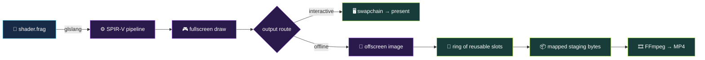
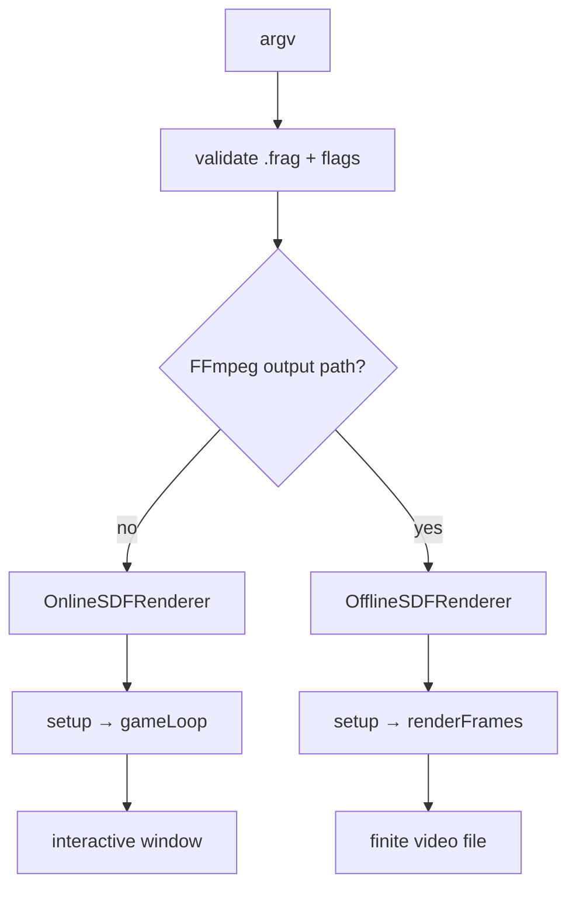
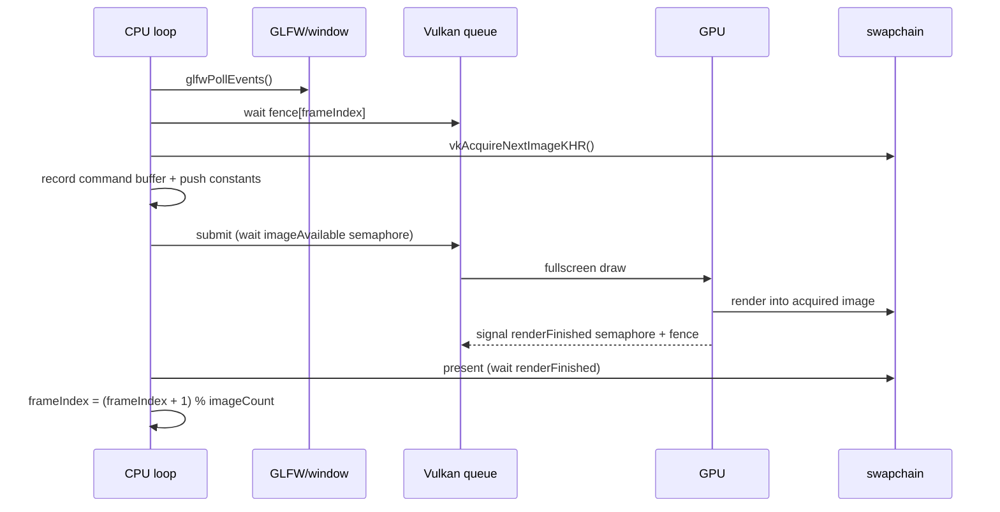
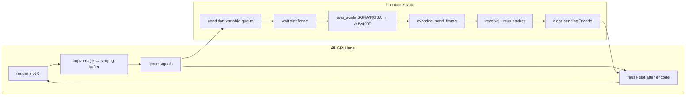

# VSDF
Vulkan SDF Renderer + Video Recorder + Hot Reloader

[](https://github.com/jamylak/vsdf/actions/workflows/linux-docker-ci.yml)
[](https://github.com/jamylak/vsdf/actions/workflows/macos-ci.yml)
[](https://github.com/jamylak/vsdf/actions/workflows/linux-smoke-tests.yml)
[](https://github.com/jamylak/vsdf/actions/workflows/windows-build-test.yml)


## License
**VSDF is licensed under GPL-3.0**

**Quickstart:** See [QUICKSTART.md](QUICKSTART.md) for installation and your first shader in minutes.

**Shell Integration:** (Experimental) See [SHELL_INTEGRATION.md](SHELL_INTEGRATION.md) for instant shader development with one command.

Render an SDF like ShaderToy using Vulkan and hot reload based on frag shader changes.
That way you can use your favourite editor / LSP and also utilise git.

<a id="hot-path"></a>

## 🧭 The hot path — a visual memory map

> **The one-line mental model:** `*.frag` → GLSL/SPIR-V → fullscreen draw → GPU image → present **or** mapped staging buffer → FFmpeg.



```text
OFFLINE SLOT CAROUSEL  ·  GPU and encoder overlap

   ┌───────┐       ┌───────┐       ┌───────┐
   │  GPU  │──────▶│ COPY  │──────▶│ ENCODE│
   │ draw  │       │ image │       │ frame │
   └───┬───┘       └───────┘       └───┬───┘
       │                               │
       └────────── reuse ◀─────────────┘

       [ slot 0 ]  →  [ slot 1 ]  →  [ slot 0 ]  →  …
          device-local image + host-visible staging buffer
```

VSDF is deliberately a thin pipeline: one fragment shader, one fullscreen draw, and a small amount of Vulkan orchestration around it. The important fork is whether the finished image goes to a window (**online**) or into a reusable GPU/CPU pipeline (**offline**).

```mermaid
flowchart LR
    A[📝 .frag shader] --> B{--toy?}
    B -->|yes| C[🧩 prepend ShaderToy wrapper<br/>iTime · iFrame · iResolution · iMouse]
    B -->|no| D[📄 use shader source as-is]
    C --> E[glslang parse + link]
    D --> E
    E --> F[⚙️ SPIR-V in memory]
    F --> G[VkShaderModule]
    G --> H[🎛️ Graphics pipeline<br/>embedded fullscreen-quad vertex shader]
    H --> I{render mode}
    I --> J[🖥️ Online: swapchain image]
    I --> K[🎞️ Offline: offscreen image]
    J --> L[Present → window]
    K --> M[Image → staging buffer]
    M --> N[Mapped CPU bytes]
    N --> O[FFmpeg swscale → YUV420P → H.264/MP4]

    classDef input fill:#18233f,stroke:#61dafb,color:#fff
    classDef gpu fill:#271849,stroke:#bd7cff,color:#fff
    classDef io fill:#173c3a,stroke:#b7f34a,color:#fff
    class A,B,C,D input
    class E,F,G,H,J,K gpu
    class L,M,N,O io
```



### 🗺️ Source-to-stage index

| Stage | What happens | Where to read it |
| --- | --- | --- |
| 1 · CLI | Chooses online vs offline; validates shader and export flags | `src/main.cpp` |
| 2 · Source | Reads `.frag`; optionally prepends the ShaderToy adapter | `src/shader_utils.cpp` |
| 3 · Compile | glslang parses + links, then emits SPIR-V directly in memory | `src/shader_utils.cpp` |
| 4 · Device | Creates Vulkan instance, picks a GPU, logical device, queue, render pass | `src/online_sdf_renderer.cpp`, `src/offline_sdf_renderer.cpp` |
| 5 · Pipeline | Loads embedded fullscreen-quad vertex shader + user fragment shader | `include/vkutils.h`, `src/*_sdf_renderer.cpp` |
| 6 · Frame | Pushes animation/input constants and records six vertices | `src/online_sdf_renderer.cpp`, `src/offline_sdf_renderer.cpp` |
| 7 · Output | Presents, or copies image bytes to host-visible memory | `include/vkutils.h`, `src/offline_sdf_renderer.cpp` |
| 8 · Encode | Converts BGRA/RGBA → YUV420P and writes packets | `src/ffmpeg_encoder.cpp` |

---

## ⚡ Every frame, in order

### 0. Startup: choose the lane

`main.cpp` parses the command line. Normal use creates `OnlineSDFRenderer`. Adding `--ffmpeg-output` switches to `OfflineSDFRenderer` and requires `--frames`, because the offline lane is a finite frame producer rather than a window loop.



### 1. Turn source into a Vulkan pipeline

The user shader is not read once and forgotten: the file watcher can trigger a safe pipeline rebuild while the old pipeline remains active if compilation fails.

```text
shader.frag
    │
    ├─ --toy ──►  template prefix
    │             ├─ PushConstants pc
    │             ├─ #define iTime / iFrame / iResolution / iMouse
    │             └─ mainImage(fragColor, flipped- Y gl_FragCoord)
    │
    └──────────► glslang::TShader
                    │ parse → link → GlslangToSpv
                    ▼
               vector<uint32_t>  (SPIR-V in memory)
                    │
                    ├─ VkShaderModule(fragment)
                    └─ VkPipeline(fullscreen vertex + fragment)
```

The vertex shader is embedded and has no vertex buffer: six generated vertices form two triangles covering the screen. That means the fragment shader does the interesting work once per output pixel, with no mesh upload or scene graph in the hot loop.

```glsl
// conceptual geometry from FULLSCREEN_QUAD_VERT_SOURCE
(-1,-1) ───── (1,-1)
   ╲       ╱      │
    ╲     ╱       │   → six vertices, one fullscreen quad
     ╲   ╱        │
(-1,1) ───── (1,1)
```

### 2. Feed the shader without descriptor traffic

Each frame is described by a tiny push-constant packet. It is copied into the command buffer immediately before `vkCmdDraw(6, 1, 0, 0)`.

```text
┌─────────────────────────────────────────────┐
│ PushConstants                                │
│  iTime       float      elapsed seconds       │
│  iFrame      uint       monotonically rising  │
│  iResolution vec2       output width/height   │
│  iMouse      vec2       cursor or (-1000,-1000)│
└─────────────────────────────────────────────┘
                         │
                         ▼
                 fragment shader, per pixel
```

The online renderer gets time from GLFW. The offline renderer uses deterministic time: `currentFrame / fps`. This is the detail that makes an exported sequence line up with its requested FPS rather than wall-clock jitter.

### 3. Online path: keep the display moving 🖥️

The loop in `OnlineSDFRenderer::gameLoop()` is the interactive hot path:



The synchronization story is intentionally visible:

* **Fence** = CPU waits until this frame slot is finished.
* **Image-available semaphore** = submission waits until the swapchain image is acquired.
* **Render-finished semaphore** = presentation waits until GPU rendering is done.
* **Swapchain** = the platform-owned set of images displayed by the window.

Resize and shader edits are slow-path events. A resize tears down/rebuilds the swapchain context; a shader edit waits for the device, destroys only the fragment pipeline objects, recompiles, and recreates the pipeline. A failed compile logs a warning and keeps the previous pipeline alive.

### 4. Offline path: overlap GPU rendering with CPU encoding 🎞️

Offline rendering replaces the swapchain with `ringSize` offscreen images. The default is **2 slots**; the hard storage ceiling is **10 slots** (`MAX_FRAME_SLOTS`). Every slot owns the complete chain below:

```text
slot[i]
┌──────────────┐   ┌──────────────┐   ┌──────────────────────┐
│ VkImage      │ → │ VkImageView  │ → │ VkFramebuffer        │
│ DEVICE_LOCAL │   │ color view   │   │ render-pass target   │
└──────────────┘   └──────────────┘   └──────────────────────┘
        │ GPU copy: image → buffer
        ▼
┌──────────────────────┐   ┌──────────────────────────────┐
│ staging VkBuffer     │ → │ mappedData (host-visible)     │
│ TRANSFER_DST         │   │ encoder reads without memcpy  │
└──────────────────────┘   └──────────────────────────────┘
```

One offline iteration is:

1. Pick `slotIndex = currentFrame % ringSize`.
2. Wait until that slot’s previous encode is finished (`pendingEncode == false`).
3. Reset its fence and record a one-time command buffer.
4. Render the fullscreen draw into the slot image.
5. Timestamp the GPU work: top-of-pipe → bottom-of-pipe.
6. Barrier `COLOR_ATTACHMENT_OPTIMAL → TRANSFER_SRC_OPTIMAL`.
7. `vkCmdCopyImageToBuffer` into the slot’s staging buffer.
8. Barrier back to `COLOR_ATTACHMENT_OPTIMAL` for the next reuse.
9. Submit and enqueue `{slotIndex, frameIndex}` for the encoder thread.



This is the core speed-up: while the CPU encodes frame **N**, the GPU can render frame **N+1** into another slot. With one slot, producer and consumer serialize. With `K ≥ 2`, the steady-state time approaches `max(render time, encode time)` rather than `render time + encode time`.

```text
1 slot:  [ GPU 0 ][ encode 0 ][ GPU 1 ][ encode 1 ]  ← bubbles / no overlap

2 slots: [ GPU 0 ][ GPU 1 ][ GPU 0 ][ GPU 1 ]
                 └── encode 0 ──┘ └── encode 1 ──┘  ← overlap
```

The condition variable provides back-pressure in both directions: the encode queue cannot grow beyond `ringSize`, and the GPU cannot overwrite a slot still owned by the encoder. That is the optimization without the correctness trap.

### 5. GPU bytes → video file

The encoder thread consumes the mapped staging bytes directly. For the default BGRA8 offscreen format, `FfmpegEncoder` tells FFmpeg the source layout and stride, then performs the only required format conversion:

```text
mapped BGRA/RGBA bytes
        │ sws_scale (bicubic)
        ▼
YUV420P ──► avcodec_send_frame ──► receive packets ──► mux ──► out.mp4
             PTS = frameIndex                 FPS = --ffmpeg-fps
```

The encoder sets a one-frame timebase (`1 / fps`), `PTS = frameIndex`, `duration = 1`, `GOP = fps`, and supports codec/preset/CRF overrides. At shutdown it flushes delayed codec frames, writes the trailer, and joins the encoder thread before Vulkan teardown.

---

## 🔬 Optimizations and trade-offs, annotated

| Choice | Why it helps | Cost / gotcha |
| --- | --- | --- |
| Fullscreen draw with embedded vertex shader | No vertex-buffer upload; tiny command recording path | Every pixel is shader work; the fragment shader is the hot computation |
| Push constants | Tiny per-frame update, no descriptor-set allocation | Payload is intentionally small: time, frame, resolution, mouse |
| SPIR-V compiled in memory | No intermediate shader file or disk round-trip | Compile/link still happens on startup and hot reload |
| Reusable offline ring slots | GPU and CPU overlap; bounded memory | More slots consume more device-local + host-visible memory |
| Host-visible, host-coherent staging buffers | Encoder reads mapped bytes directly | Device→host transfer still exists; it is explicit and synchronized |
| Per-slot fences + condition variable | Safe reuse and bounded queue/back-pressure | A slow encoder eventually makes the producer wait — by design |
| Swapchain image count capped at `MAX_FRAME_SLOTS` | Fixed-size arrays avoid unnecessary heap/vector churn | Hardware image count is bounded to the fixed maximum |
| GPU timestamps + CPU wall time | Window title exposes GPU/CPU cost together | Timestamp query reads wait for results; it is observability, not free |
| Optional `--debug-dump-ppm` | Easy smoke-test/readback proof | Intentionally stalls the online path; use for debugging, not benchmarks |

### 🧪 What to look at while profiling

* If **GPU ms** dominates: inspect SDF iterations, branching, resolution, and expensive texture/noise operations in the `.frag`.
* If **CPU ms** dominates online: inspect synchronization, resize/rebuild events, logging, or debug readback.
* If offline export backs up: compare GPU render time with FFmpeg encode time; increase `--ffmpeg-ring-buffer-size` up to the useful point, but remember the ring only hides imbalance — it cannot make the slower stage faster.
* Benchmark without `--debug-dump-ppm`; the flag adds a blocking copy/readback by design.

## 🧰 A guided repo walk-through

Use this order when explaining the project to someone (or to future-you):

```text
① src/main.cpp
   “Where does the mode fork happen?”
        ↓
② src/shader_utils.cpp + include/shader_templates.h
   “How does a ShaderToy-ish file become SPIR-V?”
        ↓
③ include/vkutils.h
   “What does the minimal Vulkan machinery look like?”
        ↓
④ src/online_sdf_renderer.cpp
   “How do acquire → draw → submit → present synchronize?”
        ↓
⑤ include/offline_sdf_renderer.h
   “What does one ring slot own?”
        ↓
⑥ src/offline_sdf_renderer.cpp
   “Where does overlap, back-pressure, and reuse happen?”
        ↓
⑦ src/ffmpeg_encoder.cpp
   “How do mapped pixels become timestamped packets?”
```

Useful commands for the tour:

```sh
# Interactive: watch a shader while editing it
vsdf --toy example.frag

# Offline: render exactly 100 deterministic frames
vsdf --toy example.frag --frames 100 --ffmpeg-output out.mp4

# Make the synchronization visible with verbose logs
vsdf --log-level debug --toy example.frag --frames 3

# Validate the GPU→CPU copy path (debug only; adds a stall)
vsdf --headless --frames 2 --debug-dump-ppm debug-frames example.frag
```

<details>
<summary>🧠 Tiny glossary</summary>

* **SDF** — signed distance field; the shader describes shape boundaries as a distance function.
* **SPIR-V** — Vulkan’s binary shader representation.
* **Swapchain** — images owned by the presentation system and rotated through the window.
* **Staging buffer** — a host-visible Vulkan buffer used here as the GPU→CPU hand-off.
* **Fence** — CPU-visible completion signal for submitted GPU work.
* **Semaphore** — GPU submission/presentation ordering signal.
* **Ring buffer** — a bounded set of reusable slots, indexed modulo `ringSize`.
* **Readback** — copying rendered pixels out of a GPU image so CPU code can inspect/encode them.

</details>

## Platforms
Supports macOS, Linux, and Windows with native file watcher implementations for each platform.

| OS | Support |
| --- | --- |
| Windows | ✅ Supported |
| Linux | ✅ Supported |
| macOS | ✅ Supported |

## Mac Setup (Homebrew)

**Easiest way to install vsdf:**

This will install MoltenVK
```sh
brew install jamylak/vsdf/vsdf
```

**For building from source or manual dependency management:**
Install Vulkan + deps with Homebrew:
```sh
brew install molten-vk vulkan-loader glslang glfw glm spdlog vulkan-tools googletest ffmpeg
# Note: FFmpeg is optional; set `-DDISABLE_FFMPEG=ON` (see `CMakeLists.txt`)
```

### Mac Lunar Setup (Optional)

https://vulkan.lunarg.com/sdk/home

Then follow the steps to do `sudo ./install_vulkan.py` in *SDK System Paths* section

#### Example `VULKAN_SDK` Env Var
`VULKAN_SDK $HOME/VulkanSDK/1.4.328.1/macOS`

## Linux Binary Installation

Pre-built binaries for Linux are available in the [GitHub Releases](https://github.com/jamylak/vsdf/releases) page.
Download the latest `vsdf-linux` binary, make it executable, and move it to a directory in your `PATH`.
The only dependency is Vulkan.

```sh
LATEST_RELEASE_TAG=$(curl -sL https://api.github.com/repos/jamylak/vsdf/releases/latest | grep '"tag_name":' | sed -E 's/.*"([^"]+)".*/\1/')
LINUX_ARCH=$( [ "$(uname -m)" = "aarch64" ] || [ "$(uname -m)" = "arm64" ] && echo arm64 || echo x86_64 )
LINUX_DIR="linux-${LINUX_ARCH}"
DOWNLOAD_URL="https://github.com/jamylak/vsdf/releases/download/${LATEST_RELEASE_TAG}/vsdf-linux-${LINUX_ARCH}.tar.gz"
echo "Downloading from: ${DOWNLOAD_URL}"
curl -LO "${DOWNLOAD_URL}"
tar -xzf vsdf-linux-${LINUX_ARCH}.tar.gz
chmod +x ${LINUX_DIR}/vsdf
sudo mv ${LINUX_DIR}/vsdf /usr/local/bin/vsdf
rm -rf vsdf-linux-${LINUX_ARCH}.tar.gz ${LINUX_DIR} # Clean up downloaded files
```

## Windows Binary Installation (no `ffmpeg`)

Pre-built Windows binaries (built without `ffmpeg`) are available on the [GitHub Releases](https://github.com/jamylak/vsdf/releases) page.
Download the latest release zip and run `vsdf.exe` from the extracted folder.

```powershell
$tag = (Invoke-RestMethod https://api.github.com/repos/jamylak/vsdf/releases/latest).tag_name
$zip = "vsdf-windows-x86_64-disable_ffmpeg.zip"
$url = "https://github.com/jamylak/vsdf/releases/download/$tag/$zip"
Invoke-WebRequest -Uri $url -OutFile $zip
Expand-Archive $zip -DestinationPath vsdf
.\vsdf\vsdf.exe --version
```

## Linux Dev Setup (Ubuntu/Debian)
Install dependencies:
```sh
sudo apt-get update
sudo apt-get install -y \
  build-essential cmake ninja-build \
  libgtest-dev libspdlog-dev \
  libglfw3 libglfw3-dev libvulkan-dev \
  glslang-tools glslang-dev libglm-dev \
  # (Optional) set -DDISABLE_FFMPEG=ON to skip \
  libavcodec-dev libavformat-dev libavutil-dev libswscale-dev \
```

## Windows Dev Setup

1. Install vcpkg (if not already installed):
   ```powershell
   git clone https://github.com/Microsoft/vcpkg.git
   cd vcpkg
   .\bootstrap-vcpkg.bat
   ```
2. Install dependencies using vcpkg (includes Vulkan):
   ```powershell
   vcpkg install vulkan:x64-windows glfw3:x64-windows glslang:x64-windows spdlog:x64-windows glm:x64-windows gtest:x64-windows
   # Note: ffmpeg is optional; set `-DDISABLE_FFMPEG=ON` (see `CMakeLists.txt`) to build without it
   vcpkg install ffmpeg[avcodec,avformat,swscale]:x64-windows
   vcpkg integrate install
   ```

## Build

### Linux/macOS
```sh
# ffmpeg is optional; set `-DDISABLE_FFMPEG=ON` (see `CMakeLists.txt`) to build without it.
git submodule update --init --recursive
cmake -B build .
cmake --build build
./build/vsdf {filepath}.frag
```

### Windows
```powershell
# ffmpeg is optional; set `-DDISABLE_FFMPEG=ON` (see `CMakeLists.txt`) to build without it.
git submodule update --init --recursive
cmake -B build -DCMAKE_TOOLCHAIN_FILE="C:/vcpkg/scripts/buildsystems/vcpkg.cmake" .
cmake --build build --config Release
.\build\Release\vsdf.exe {filepath}.frag
```

## Install

### System-wide Install

To make `vsdf` available as a command in your shell, you can install it to a standard system directory like `/usr/local`.

**Linux/macOS**
```sh
# Pick somewhere in your PATH and install it there
cmake --install build --prefix /usr/local
vsdf {filepath}.frag
```

On Windows, you can also install to a custom location and add that location to your `PATH` environment variable to make it accessible from any command prompt.

## Usage
### With shader toy shaders (most seem to work)
```sh
vsdf --new-toy example.frag
vsdf --toy example.frag
```

### Offline MP4 encoding (`ffmpeg` / H.264 via libx264):
```sh
vsdf --toy example.frag --frames 100 --ffmpeg-output out.mp4
```

### Example test command using a sample shader in this repo
```sh
vsdf --toy example.frag
```

Note: That if you use `--toy` we will prepend a template
which links up the push constants
like `iTime` and we will also follow this logic.

```cpp
if (useToyTemplate) {
    Client = glslang::EShClientOpenGL;
    ClientVersion = glslang::EShTargetOpenGL_450;
} else {
    Client = glslang::EShClientVulkan;
    ClientVersion = glslang::EShTargetVulkan_1_0;
}
```

### CLI Flags
- `--help` Show this help message
- `--version` Show version information
- `--new-toy [name]` Create a new shader file with starter template. Prints the filename and exits. Generates random name like my_new_toy_12345.frag if not provided.
- `--template <name>` Template to use with `--new-toy` (default, plot)
- `--toy` Use ShaderToy-style template wrapper
- `--no-focus` Don't steal window focus on startup and float
- `--headless` Hide the GLFW window (pair with `xvfb-run` in CI)
- `--frames <N>` Render N frames then exit
- `--log-level <trace|debug|info|warn|error|critical|off>` Set `spdlog` verbosity (default: info)
- `--debug-dump-ppm <dir>` Copy the swapchain image before present (adds a stall); mainly for smoke tests or debugging
- `--ffmpeg-output <file>` Enable offline encoding; output file path (requires `--frames`)
- `--ffmpeg-fps <N>` Output FPS (default: 30)
- `--ffmpeg-crf <N>` Quality for libx264 (default: 20; lower is higher quality)
- `--ffmpeg-preset <name>` libx264 preset (default: slow)
- `--ffmpeg-codec <name>` FFmpeg codec (default: libx264)
- `--ffmpeg-width <N>` Output width (default: 1280)
- `--ffmpeg-height <N>` Output height (default: 720)
- `--ffmpeg-ring-buffer-size <N>` Ring buffer size for offline render (default: 2)

## Test Build

### Linux/macOS
```sh
git submodule update --init --recursive
cmake -B build -DBUILD_TESTS=ON -DDEBUG=ON
cmake --build build
./build/tests/vsdf_tests
./build/tests/filewatcher/filewatcher_tests
```

### Windows
```powershell
git submodule update --init --recursive
cmake -B build -DBUILD_TESTS=ON -DCMAKE_BUILD_TYPE=Debug -DCMAKE_TOOLCHAIN_FILE="C:/path/to/vcpkg/scripts/buildsystems/vcpkg.cmake" .
cmake --build build --config Debug
.\build\tests\vsdf_tests\Debug\vsdf_tests.exe
.\build\tests\filewatcher\Debug\filewatcher_tests.exe
```

## Nix
### Nix Develop Shell
```sh
nix develop
```

### Nix Run / Install (one command)
Run without installing (builds and runs):
```sh
nix run github:jamylak/vsdf -- --new-toy example.frag
nix run github:jamylak/vsdf -- --toy example.frag
```

Install into your profile (then `vsdf` is on PATH):
```sh
nix profile install github:jamylak/vsdf
```

Open a one-off shell with `vsdf` available:
```sh
nix shell github:jamylak/vsdf
```

### Home Manager (flake) install
```nix
# flake.nix
{
  inputs.vsdf.url = "github:jamylak/vsdf";
}
```
```nix
# home.nix
{ inputs, pkgs, ... }:
{
  home.packages = [
    inputs.vsdf.packages.${pkgs.system}.default
  ];
}
```

### Manually create your own vulkan compatible shader
If you don't want any template prepended or you want
to use a Vulkan shader directly you can copy `shaders/vulktemplate.frag`
and adjust it to your liking

- See `shaders/vulktemplate.frag` to see how push constants
  are passed in

```sh
# Then call it without the --toy flag
vsdf path/to/shader.frag
```

The binary uses [volk](https://github.com/zeux/volk) to dynamically find Vulkan at runtime, so it works regardless of installation location.


### Credits:
- https://shadertoy.com
- https://iquilezles.org/
- https://www.youtube.com/playlist?list=PL0JVLUVCkk-l7CWCn3-cdftR0oajugYvd (zeux)
- https://github.com/SaschaWillems/Vulkan

### CPP Guidelines
(I should try follow this but haven't gotten through it all yet)
https://isocpp.github.io/CppCoreGuidelines/CppCoreGuidelines
